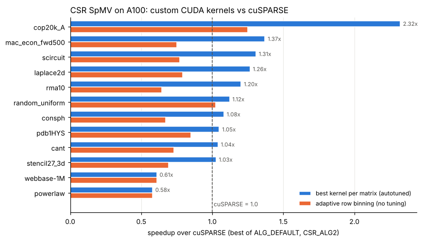
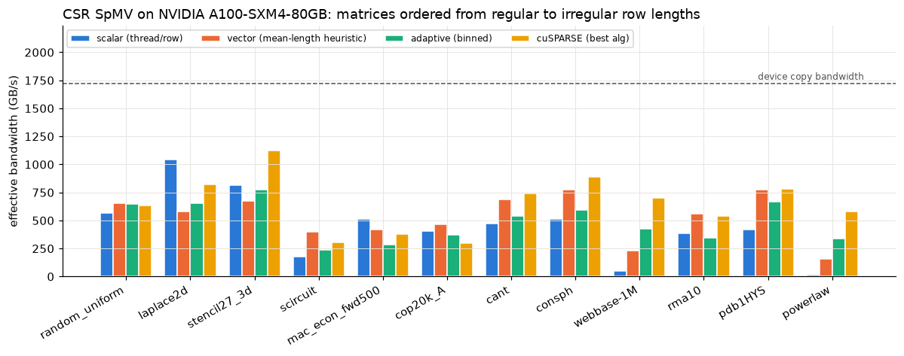
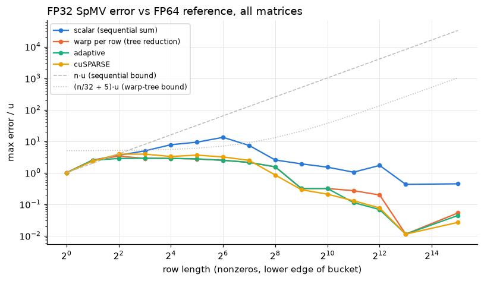

# CSR SpMV on NVIDIA GPUs: custom CUDA kernels vs cuSPARSE, plus cuTile

Sparse matrix-vector multiply (`y = A x`, CSR, FP32) written from scratch in CUDA C++ and in **cuTile Python**,
benchmarked against **cuSPARSE** on an **NVIDIA A100-SXM4-80GB** across 12 matrices: 8 classic SpMV benchmark
matrices from the **SuiteSparse** collection and 4 synthetic ones (structured stencils, random, power law).
Every result is checked against an FP64 reference with a componentwise floating-point error analysis.



## Key results (A100-SXM4-80GB, CUDA 12.6, cold L2, median of 30 runs)

* **Autotuned custom kernels beat cuSPARSE on 10 of 12 matrices** (7 by 5% or more), up to
  **2.32x on cop20k_A**, geomean 1.10x. "Autotuned" means picking the fastest
  of the 7 kernel variants for each matrix, which is what a library or solver can do once per matrix and reuse
  over thousands of SpMV calls.
* **cuSPARSE still wins on power-law matrices** (webbase-1M 0.61x, synthetic power law
  0.58x), where rows range from 1 to tens of thousands of nonzeros.
* **Load balancing matters on irregular matrices:** binning rows by length and launching a specialized kernel per
  bin is **18.5x faster than one-thread-per-row** on the power-law matrix and
  8.6x on webbase-1M.
* **The classic mean-row-length heuristic for threads per row picked the best setting on only 1 of 12 matrices**
  and was 1.27x slower than autotuning on geomean.
* **Floating-point error:** all kernels agree with the FP64 reference (no wrong or missing rows). Warp-cooperative
  tree reductions cut the worst-case FP32 error **1.3x to 4.8x** compared with sequential row sums
  (max 3.36u vs 13.29u, where u = 2^-24), and the adaptive kernel's worst-case error is
  below cuSPARSE's on all 12 matrices.
* **cuTile Python:** the same row-binning algorithm in about 20 lines of tile code, compiled into one specialized
  kernel per row-length group. Correct on all 12 matrices (max error 3.36u) and reaching
  0.54x of the hand-written CUDA C++ kernel's throughput on geomean (GPU time only).

## Results per matrix

Times in microseconds. "Best custom" is the fastest of scalar, vector (2 to 32 threads per row) and adaptive.

| matrix | type | rows | nnz | mean / max row length | cuSPARSE | best custom kernel | best (us) | vs cuSPARSE | adaptive (us) | adaptive vs scalar |
|---|---|---:|---:|---:|---:|---|---:|---:|---:|---:|
| cant | FEM cantilever | 62,451 | 4,007,383 | 64.2 / 78 | 44.4 | vector8 | 42.7 | **1.04x** | 60.9 | 1.14x |
| pdb1HYS | protein | 36,417 | 4,344,765 | 119.3 / 204 | 44.9 | vector16 | 42.8 | **1.05x** | 52.9 | 1.59x |
| rma10 | 3D CFD | 46,835 | 2,374,001 | 50.7 / 145 | 36.2 | vector8 | 30.1 | **1.20x** | 56.1 | 0.91x |
| cop20k_A | FEM accelerator | 121,192 | 2,624,331 | 21.7 / 81 | 74.9 | vector8 | 32.3 | **2.32x** | 60.0 | 0.92x |
| consph | FEM spheres | 83,334 | 6,010,480 | 72.1 / 81 | 55.3 | vector8 | 51.2 | **1.08x** | 82.4 | 1.16x |
| mac_econ_fwd500 | economics | 206,500 | 1,273,389 | 6.2 / 44 | 33.7 | scalar | 24.6 | **1.37x** | 45.0 | 0.55x |
| scircuit | circuit | 170,998 | 958,936 | 5.6 / 353 | 31.9 | vector8 | 24.4 | **1.31x** | 41.4 | 1.32x |
| webbase-1M | web graph | 1,000,005 | 3,105,536 | 3.1 / 4,700 | 52.4 | adaptive | 86.1 | **0.61x** | 86.1 | 8.56x |
| laplace2d | 2D Poisson (synthetic) | 1,048,576 | 5,238,784 | 5.0 / 5 | 66.1 | scalar | 52.3 | **1.26x** | 83.5 | 0.63x |
| stencil27_3d | 3D 27-pt stencil (synthetic) | 512,000 | 13,481,272 | 26.3 / 27 | 101.5 | vector2 | 98.9 | **1.03x** | 146.9 | 0.95x |
| random_uniform | random 16/row (synthetic) | 1,000,000 | 15,999,878 | 16.0 / 16 | 221.2 | vector4 | 197.3 | **1.12x** | 215.8 | 1.15x |
| powerlaw | power law (synthetic) | 1,000,000 | 8,352,263 | 8.4 / 48,795 | 135.2 | adaptive | 233.7 | **0.58x** | 233.7 | 18.51x |



Effective bandwidth counts compulsory traffic only (values, column indices, row pointers, x once, y once), so it
understates the real traffic of the scattered `x[col]` reads. The best kernels reach 41 to 67% of the measured
device copy bandwidth (1,721 GB/s) on the three large synthetic matrices (5 to 16 million nonzeros). The SuiteSparse
matrices are small enough (1 to 6 million nonzeros, 25 to 90 microseconds per SpMV) that launch and tail effects
are a large share of the time.

## Floating-point error analysis

Error per row is `|y_i - y_ref_i| / (|A| |x|)_i` in units of FP32 roundoff `u = 2^-24`, the componentwise
measure used for dot products. Recursive (sequential) summation of n terms has a worst-case bound of about n·u;
a tree reduction over 32 lanes about (n/32 + log2 32)·u.



| matrix | scalar (sequential) | warp per row (tree) | adaptive | cuSPARSE | sequential / tree |
|---|---:|---:|---:|---:|---:|
| cant | 4.96 | 1.89 | 1.89 | 2.43 | 2.6x |
| pdb1HYS | 7.33 | 2.12 | 2.12 | 2.63 | 3.5x |
| rma10 | 13.29 | 2.78 | 2.88 | 3.62 | 4.8x |
| cop20k_A | 9.13 | 2.08 | 2.08 | 2.76 | 4.4x |
| consph | 6.74 | 1.85 | 1.85 | 2.19 | 3.6x |
| mac_econ_fwd500 | 5.96 | 3.36 | 2.82 | 3.89 | 1.8x |
| scircuit | 6.54 | 2.88 | 2.85 | 3.83 | 2.3x |
| webbase-1M | 7.74 | 2.59 | 2.59 | 3.51 | 3.0x |
| laplace2d | 2.75 | 2.09 | 2.09 | 2.84 | 1.3x |
| stencil27_3d | 4.02 | 1.77 | 1.77 | 2.06 | 2.3x |
| random_uniform | 3.43 | 2.20 | 2.01 | 2.66 | 1.6x |
| powerlaw | 3.62 | 2.55 | 2.61 | 2.89 | 1.4x |

Observed errors are far below the worst-case bounds because rounding errors of mixed-sign products partly
cancel, but the ordering is consistent: sequential row sums are the least accurate on every matrix.

## cuTile Python version

`spmv_cutile.py` groups rows by length class and launches one specialization of a single tile kernel per group:
a block owns R rows and each loop step gathers an R x W tile of nonzeros (`ct.gather`), multiplies by the gathered
`x` values and reduces along the row (`ct.sum`). The tile shape (R, W) is a compile-time constant, so cuTile
compiles a separate kernel for each group. Needs an Ampere-or-newer GPU.

| matrix | launches | cuTile GPU time (us) | CUDA C++ adaptive (us) | cuSPARSE (us) | cuTile vs CUDA C++ | max error (u) |
|---|---:|---:|---:|---:|---:|---:|
| cant | 4 | 128.7 | 60.9 | 44.4 | 0.47x | 1.92 |
| pdb1HYS | 4 | 97.6 | 52.9 | 44.9 | 0.54x | 1.91 |
| rma10 | 7 | 66.7 | 56.1 | 36.2 | 0.84x | 2.92 |
| cop20k_A | 6 | 80.1 | 60.0 | 74.9 | 0.75x | 2.37 |
| consph | 5 | 183.8 | 82.4 | 55.3 | 0.45x | 1.80 |
| mac_econ_fwd500 | 5 | 40.4 | 45.0 | 33.7 | 1.11x | 3.36 |
| scircuit | 8 | 48.3 | 41.4 | 31.9 | 0.86x | 2.88 |
| webbase-1M | 11 | 274.4 | 86.1 | 52.4 | 0.31x | 2.59 |
| laplace2d | 2 | 157.6 | 83.5 | 66.1 | 0.53x | 2.09 |
| stencil27_3d | 3 | 388.7 | 146.9 | 101.5 | 0.38x | 1.77 |
| random_uniform | 1 | 448.8 | 215.8 | 221.2 | 0.48x | 2.20 |
| powerlaw | 11 | 887.2 | 233.7 | 135.2 | 0.26x | 2.55 |

GPU time comes from the PyTorch profiler (sum of kernel durations), so it excludes Python launch overhead.
cuTile is closest to the CUDA C++ version on the small irregular matrices (mac_econ_fwd500 1.11x, scircuit and
rma10 about 0.85x) and furthest behind on the power-law matrices (0.26x to 0.31x), where groups of long rows get
few rows per block and padded lanes in each tile waste work.

## Kernels

| kernel | idea |
|---|---|
| `scalar` | one thread per row, sequential sum |
| `vector2` to `vector32` | T threads per row, strided loads, warp-shuffle tree reduction (autotuning sweep over T) |
| `adaptive` | rows binned by length; bins up to 32 nonzeros use 2 to 16 threads per row, up to 2,048 use a warp, longer rows a 256-thread block; one launch per non-empty bin |
| `cusparse_default`, `cusparse_csr_alg2` | `cusparseSpMV` with descriptors and workspace created once, outside the timed region |
| `spmv_csr_tile` (cuTile) | row-length groups, R x W gathered tiles, one specialized kernel per group |

## Methodology

* **Timing:** CUDA events around each SpMV, a 256 MB memset before every timed run so the L2 cache is cold, two
  warm-up runs, median of 30 runs. cuSPARSE descriptors and buffers are created outside the timed region.
* **Correctness:** before timing, `y` is filled with NaN so any row a kernel forgets shows up, then compared with an
  FP64 reference computed on the GPU.
* **Input vector:** deterministic pseudo-random x in [-1, 1), identical in C++ and Python.
* **Matrices:** SuiteSparse Matrix Market files (Williams, Bova and Hamm groups) plus synthetic matrices generated
  with SciPy; duplicates summed, column indices sorted.

## Reproduce

1. GPU with CUDA 12+, `nvcc`, Python 3.10+, and: `pip install numpy scipy pandas matplotlib jupyter torch "cuda-tile[tileiras]"`
   (cuTile only on Ampere or newer; on older GPUs that section is skipped).
2. Download the 8 matrices in Matrix Market format from the
   [SuiteSparse collection](https://sparse.tamu.edu) (or the
   [University of Florida mirror](https://www.cise.ufl.edu/research/sparse/MM/)) and put the `.tar.gz` files in
   `spmv_work/mtx/`. Without them the notebook runs on the 4 synthetic matrices only.
3. Run the notebook: `jupyter nbconvert --to notebook --execute --inplace --ExecutePreprocessor.timeout=-1 SpMV_cuSPARSE_cuTile.ipynb`
   Results land in `spmv_results/<gpu>/`.

Environment variables: `SPMV_SUITESPARSE=0` (synthetic only), `SPMV_SCALE=0.25` (smaller synthetic matrices),
`SPMV_SKIP_CUTILE=1`.

## Repository layout

```
SpMV_cuSPARSE_cuTile.ipynb     executed notebook (A100 run): builds, runs, analyzes, plots
spmv_bench.cu                  CUDA C++ kernels, cuSPARSE baseline, FP64 reference, timing harness
spmv_lib.py                    matrix suite, CSR I/O, result parsing, cuTile row grouping (+ NumPy emulation)
spmv_cutile.py                 cuTile Python SpMV kernel
spmv_results/NVIDIA_A100-SXM4-80GB/
    spmv_results.csv           every kernel x matrix: time, GB/s, GFLOP/s, error
    per_matrix_summary.csv     best kernel per matrix vs cuSPARSE
    error_buckets.csv          max error by row-length class
    cutile.csv, matrices.csv, SUMMARY.md, *.png
```

## Limitations and next steps

* The adaptive kernel's bin thresholds give every row of 33 to 2,048 nonzeros a full warp. The autotuning sweep
  shows 8 to 16 threads per row is faster for those lengths, which is why a single tuned vector kernel beats the
  adaptive one on the regular matrices. Next: tune threads per row per bin, not per matrix.
* Power-law matrices: try merge-path or CSR-stream style load balancing (split nonzeros, not rows, evenly).
* The vector `x` is read through the read-only cache with no reordering; RCM reordering or blocking for locality
  is untested.
* One GPU (A100). Next: H100 and an Ada-generation GPU, and FP64 / mixed-precision variants.
